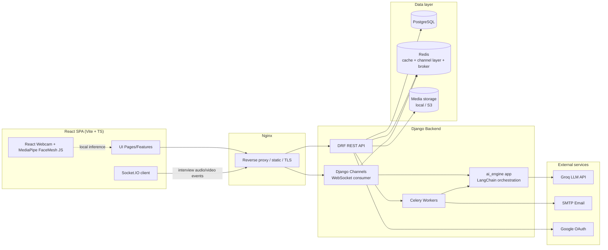
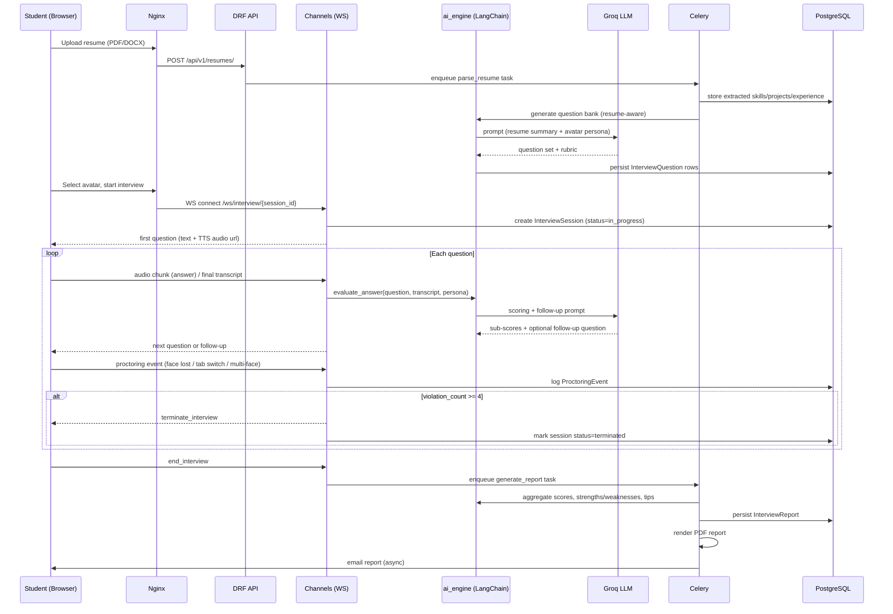
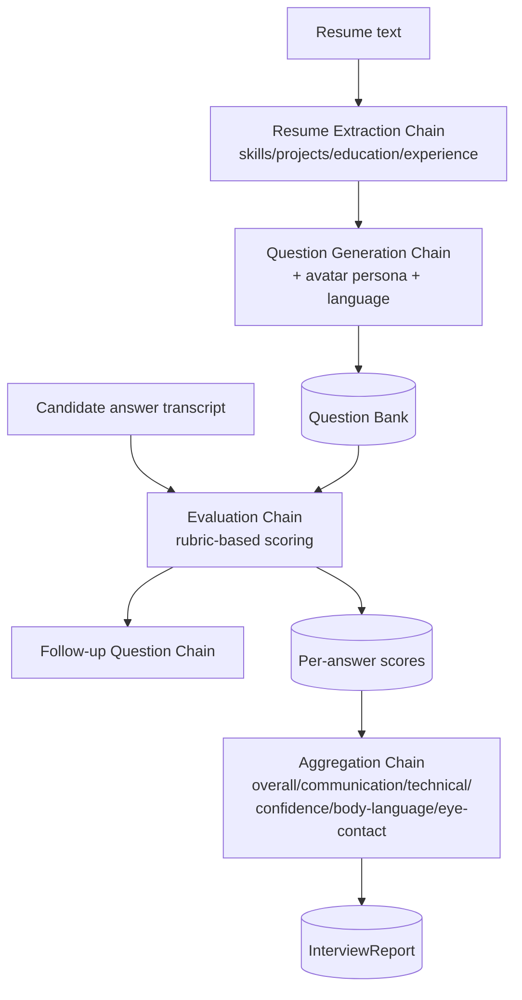

# Architecture — AI_AvatarInterview

## 1. System overview



## 2. Request flow — a full interview session



## 3. Clean architecture layering (backend)

Each Django app under `backend/apps/` is organized internally as:

```
apps/<domain>/
├── models.py          # persistence layer (ORM)
├── serializers.py      # DRF request/response schemas
├── views.py / viewsets.py   # HTTP interface layer
├── services.py          # business logic (framework-agnostic where possible)
├── selectors.py          # read/query logic, separated from mutations
├── permissions.py        # object/action-level authorization
├── tasks.py               # Celery async tasks
├── signals.py               # domain events (e.g., resume uploaded -> parse)
├── urls.py
└── tests/
```

Rules:
- **Views** stay thin — they parse/validate input (via serializers) and delegate to `services.py`.
- **Services** hold business logic and are the only layer allowed to call across apps (e.g., `interviews.services` calling `ai_engine.services`).
- **Selectors** hold read-only query logic so views/services don't build ad-hoc ORM queries inline.
- **`ai_engine`** is the single integration boundary for LangChain/Groq — no other app talks to the LLM directly, so swapping providers (Groq → Gemini → Ollama) touches one app.
- **`common/`** holds cross-cutting concerns: base models (UUID PK, timestamps), pagination classes, custom exceptions, permission mixins.

## 4. Frontend architecture (feature-based)

```
frontend/src/
├── app/            # store.ts (Redux Toolkit), router.tsx, App.tsx
├── features/       # one folder per domain, each owns its slice + api + components
│   ├── auth/          # login, signup, forgot/reset password, slice, api
│   ├── dashboard/
│   ├── avatars/
│   ├── interview/     # webcam, proctoring hooks, WS client, question flow
│   ├── resume/
│   ├── results/
│   └── admin/
├── components/     # shared, presentational (Button, Card, Modal, Chart wrappers)
├── layouts/        # AuthLayout, DashboardLayout, InterviewLayout
├── hooks/          # useAuth, useWebSocket, useProctoring, useTheme
├── services/       # axios instance, interceptors, REST clients per resource
├── locales/        # en/hi/te i18n JSON via react-i18next
└── styles/         # tailwind base, theme tokens (light/dark)
```

State strategy: Redux Toolkit for auth/session/global UI state; RTK Query (or plain Axios + React Query-style hooks) for server cache; local component state for ephemeral UI.

## 5. Real-time proctoring pipeline

- **Client-side (fast path, low latency):** MediaPipe FaceMesh/Face Detection running in-browser (WASM) on the webcam feed for face presence, eye landmarks, head pose estimation. Violations are raised as WS events immediately — no need to round-trip video to the server for every frame.
- **Server-side (periodic verification):** every N seconds a downsampled frame is sent over the WebSocket to the backend, which re-runs MediaPipe/OpenCV (Python) server-side to cross-check the client's report (defense against a tampered client) and to detect multiple faces reliably.
- Non-visual signals (tab switch, window blur, devtools open, mic/camera disabled, offline) are detected purely client-side via browser APIs (`visibilitychange`, `blur`, `navigator.mediaDevices`, `online`/`offline`) and reported as the same `ProctoringEvent` stream.
- All violations funnel into one counter per session; on the 4th violation the WS consumer force-ends the interview and the event history is persisted for the admin panel.

## 6. AI engine design



All chains are implemented with LangChain `Runnable` pipelines behind a single `LLMClient` abstraction (`apps/ai_engine/services.py`) so the provider (Groq now; Gemini/OpenRouter/Ollama later) is a config value, not a code change.

## 7. Deployment topology (Docker Compose, local/staging)

```mermaid
flowchart LR
    subgraph Host
        NGINX[nginx:alpine] --> FE[frontend\n(vite build, served as static)]
        NGINX --> BE[backend\n(gunicorn + uvicorn worker for ASGI)]
        BE --> DB[(postgres:16)]
        BE --> RD[(redis:7)]
        CW[celery worker] --> RD
        CB[celery beat] --> RD
        CW --> DB
    end
```

Production targets a managed Postgres/Redis and object storage (S3-compatible) instead of the in-container versions — see [DEPLOYMENT.md](DEPLOYMENT.md) (Phase 9).

## 8. Security model summary

| Concern | Mechanism |
|---|---|
| AuthN | JWT (SimpleJWT), short-lived access + rotating refresh tokens |
| AuthZ | DRF permission classes per viewset + object-level checks in services |
| Transport | Nginx terminates TLS; HSTS in prod settings |
| Passwords | Django's PBKDF2 hasher (default), never logged/serialized |
| CORS | `django-cors-headers`, explicit allow-list from env |
| CSRF | Django CSRF middleware for cookie-based flows; JWT bearer flow is exempt by design (stateless) |
| Rate limiting | DRF throttling classes (per-user, per-IP) on auth & interview endpoints |
| Injection | Django ORM (parameterized) everywhere; no raw SQL string interpolation |
| XSS | React auto-escaping + DOMPurify for any rendered rich text |
| File upload safety | MIME/type + size validation on resume/photo uploads, virus-scan hook point in `resumes.services` |

## 9. Multi-language support

`django-modeltranslation`-free approach: question/prompt templates and static UI strings are keyed by locale (`en`/`hi`/`te`); the LLM is instructed (via prompt) to answer in the target language; TTS voice selection maps `language + avatar` → a voice ID. Frontend uses `react-i18next` with JSON resource bundles under `frontend/src/locales/<lang>/`.
