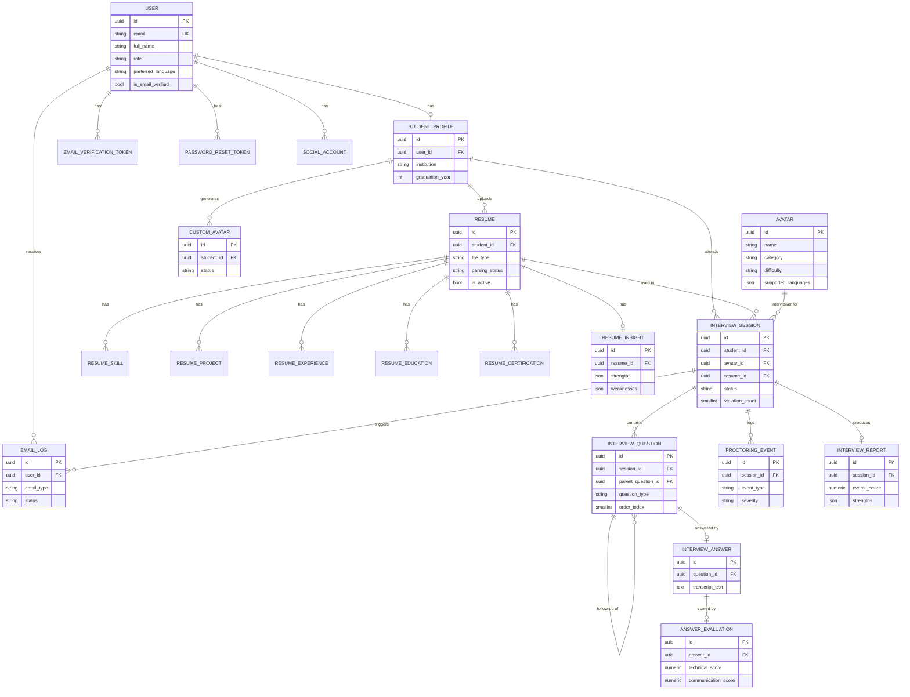

# Database Design — AI_AvatarInterview

PostgreSQL, normalized to 3NF, UUID primary keys everywhere (`common.models.BaseModel`), every table carries `created_at`/`updated_at`.

- Django models: `backend/apps/*/models.py` (source of truth; migrations generated from these in Phase 3)
- Raw SQL reference: [sql/schema.sql](sql/schema.sql)

## 1. Entity-relationship diagram

*(`RESUME_SKILL`, `RESUME_PROJECT`, `RESUME_EXPERIENCE`, `RESUME_EDUCATION`, `RESUME_CERTIFICATION`, `SOCIAL_ACCOUNT`, `EMAIL_VERIFICATION_TOKEN`, `PASSWORD_RESET_TOKEN` are simple child tables of `RESUME`/`USER` — see [schema.sql](sql/schema.sql) for their full column lists.)*

## 2. Table-by-app breakdown

| App | Tables | Purpose |
|---|---|---|
| `users` | `users`, `student_profiles`, `email_verification_tokens`, `password_reset_tokens`, `social_accounts` | AuthN identity + student profile extension |
| `avatars` | `avatars`, `custom_avatars` | Built-in persona catalog + per-student generated avatars |
| `resumes` | `resumes`, `resume_skills`, `resume_projects`, `resume_experiences`, `resume_education`, `resume_certifications`, `resume_insights` | Uploaded resume + normalized extracted entities + LLM qualitative summary |
| `interviews` | `interview_sessions`, `interview_questions`, `interview_answers`, `answer_evaluations` | The interview itself: session lifecycle, question tree (with follow-ups via self-FK), answers, per-answer AI scoring |
| `monitoring` | `proctoring_events` | Every proctoring signal (vision + browser-level), append-only |
| `reports` | `interview_reports` | One aggregated, final report per session |
| `notifications` | `email_logs` | Audit trail of every transactional email sent |
| `admin_panel` | `language_configs`, `ai_model_configs`, `platform_settings` | Admin-editable platform configuration (no redeploy needed to change active LLM, supported languages, etc.) |

## 3. Key design decisions

- **UUID PKs, not auto-increment ints.** IDs are exposed in URLs (`/interviews/{id}/`) and must not be enumerable/guessable.
- **`InterviewQuestion.parent_question` self-FK** models follow-up questions as children of the question that triggered them, rather than a separate table — keeps the question timeline in one place and orderable by `order_index`.
- **`InterviewAnswer` and `AnswerEvaluation` are separate from `InterviewQuestion`**, each one-to-one, because they're written at different times by different actors (student answers live; the AI scores asynchronously) — splitting them avoids partially-null rows on the hot path.
- **Resume extraction is normalized** (`resume_skills`, `resume_projects`, `resume_experiences`, `resume_education`, `resume_certifications`) rather than stored as one JSON blob, so the platform can query/filter/aggregate on them later (e.g. "students with React experience"). `strengths`/`weaknesses` stay as JSON on `resume_insights` because they're LLM free-text, not independently queried entities.
- **`ai_model_configs` has a partial unique index** (`unique_active_config_per_purpose`) — only one *active* config per purpose, enforced at the DB level, so the admin panel can't accidentally leave two active LLM configs racing for the same task.
- **`resumes.is_active`** flags the most recent resume per student; older resumes are kept (not deleted) so past interview sessions still resolve the resume they were actually generated from (`interview_sessions.resume_id`, `ON DELETE SET NULL`).
- **Cascade rules:** child data (questions, answers, evaluations, proctoring events, resume sub-entities) cascades on delete of its parent; `interview_sessions.avatar_id` uses `ON DELETE RESTRICT` — an avatar used by any session can't be hard-deleted (deactivate via `is_active` instead).

## 4. Indexing strategy

| Table | Index | Why |
|---|---|---|
| `users` | `role`, unique `email` | Login lookup by email; admin filters by role |
| `student_profiles` / `resumes` / `custom_avatars` | `(student_id, is_active)` / `(student_id, status)` | Dashboard "current resume" / "current avatar" lookups |
| `interview_sessions` | `(student_id, status)`, `started_at` | Dashboard stats (completed/upcoming), reporting time-ranges |
| `interview_questions` | `(session_id, order_index)` | Ordered question playback during a session |
| `proctoring_events` | `(session_id, event_type)`, `(session_id, severity)` | Live violation counting, per-type analytics |
| `email_logs` | `(user_id, email_type)` | Resend/debug lookups |
| `ai_model_configs` | partial unique `(purpose) WHERE is_active` | Enforce single active provider per AI task |

## 5. Wiring into Django

The full Django project (`config/settings`, `INSTALLED_APPS`, `AUTH_USER_MODEL = "users.User"`, each app's `apps.py`) lives alongside these models — see [ARCHITECTURE.md](ARCHITECTURE.md) for the project layout. Run `python manage.py migrate` to apply the schema (the 10 built-in avatars and default admin config seed automatically via data migrations, `avatars/migrations/0003_seed_avatars.py` and `admin_panel/migrations/0002_seed_defaults.py`).
